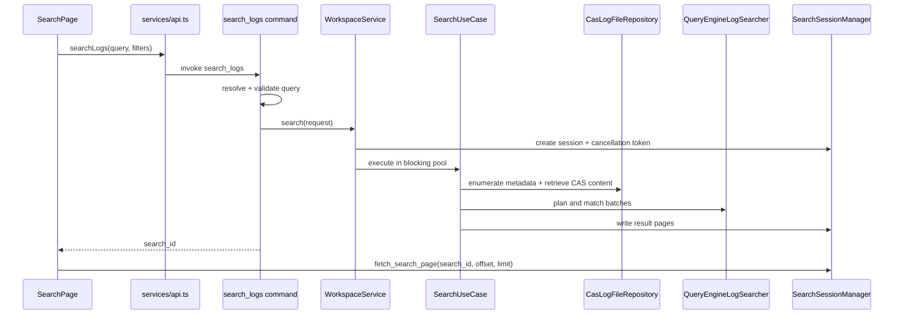

# 搜索链路

搜索从 React 页面发起，经 Tauri command 解析和验证后，由 `WorkspaceService` / `SearchUseCase` 编排。查询引擎按计划匹配内容，过滤器约束候选记录，结果最终进入 `DiskResultStore`。

## 查询规划

`QueryEngineLogSearcher` 根据查询形状选择更合适的匹配方式：

- 简单单模式可走 Memchr 路径。
- 多模式 OR 查询可使用 Aho-Corasick。
- 标准正则交给 Rust `regex`。
- look-around 模式使用 Fancy 引擎。

进入执行前，查询验证器会检查嵌套量词、重叠交替等高风险结构（ReDoS 防护）。

规划产物通过 **`MatchPlan` trait**（`la-core/domain/search.rs`，P7 引入）对象化传递：搜索引擎返回 `Box<dyn MatchPlan>`，执行期直接调用其匹配方法，不再依赖 `Any` 向下转型或外部 side-map 表，类型安全在编译期保证。QueryPlanner 结果经 Moka Cache 两层缓存（查询 → 计划、计划 → 编译正则）。

## 批处理与过滤

`SearchUseCase::run_blocking`（`application/search.rs`）是搜索编排器：按文件顺序分段，派发小文件或大文件策略，并持有一个由两种策略共享的 `SearchBatch`（`application/search_batch.rs`）。`ParallelSmallFileStrategy` 和 `StreamingLargeFileStrategy` 均为 `application/search_strategy.rs` 中的具体实现；前者使用 Rayon 并行处理小文件并按输入顺序消费结果，后者对大于等于 64 KiB 的文件按 512 行流式读取。策略实现细节留在该模块，`SearchUseCase` 对外接口保持不变。

`SearchBatch` 分批处理文件与结果，避免无限累积。关键常量按编排器和策略模块分别归属：

| 常量 | 值 | 作用 | 定义位置 |
| --- | --- | --- | --- |
| `BATCH_SIZE` | 256 | 单批聚合的命中结果数，写盘前缓冲 | `application/search.rs` |
| `FILE_CHUNK_SIZE` | 10 | 每轮并行处理的小文件数 | `application/search.rs` |
| `LARGE_FILE_STREAM_THRESHOLD_BYTES` | 64 KiB | 大于等于该大小的文件走流式分块路径 | `application/search_strategy.rs` |
| `SEARCH_LINE_CHUNK_SIZE` | 512 | 大文件每次读取的行数（`read_line_chunks_sync`） | `application/search_strategy.rs` |

大文件（≥ 64 KiB）由 `StreamingLargeFileStrategy` 按 512 行一块流式处理，小文件则由 `ParallelSmallFileStrategy` 使用 Rayon 并行匹配，但按输入文件顺序消费结果。两条路径通过同一个编排器持有的 `SearchBatch` 共享批量、全局截断与结果写盘逻辑。`CompiledSearchFilters` 把时间范围、日志级别掩码和文件路径规则编译为统一 domain `Filter`，在结果写盘前执行。

## 会话所有权

`SearchSessionManager` 统一管理：

- 新会话与 `search_id`
- cancellation token 注册与取消
- 结果分页读取
- token 清理与结果会话生命周期

这个边界让 `cancel_search` 和 `fetch_search_page` 不需要遍历工作区或猜测结果存储位置。

会话内传递的查询计划同样遵循编译期安全原则：`MatchPlan` trait（P7）把匹配计划封装为对象随会话流转，执行期直接调用其方法，不再依赖 `Any` 向下转型或外部 side-map 映射表——计划与会话之间不存在字符串键查找，类型不匹配在编译期即被拒绝。

## 性能判断

搜索耗时通常由三个因素共同决定：扫描内容量、每行匹配成本、命中结果量。时间和文件模式过滤能减少输入，查询规划降低匹配成本，磁盘分页控制输出内存。

